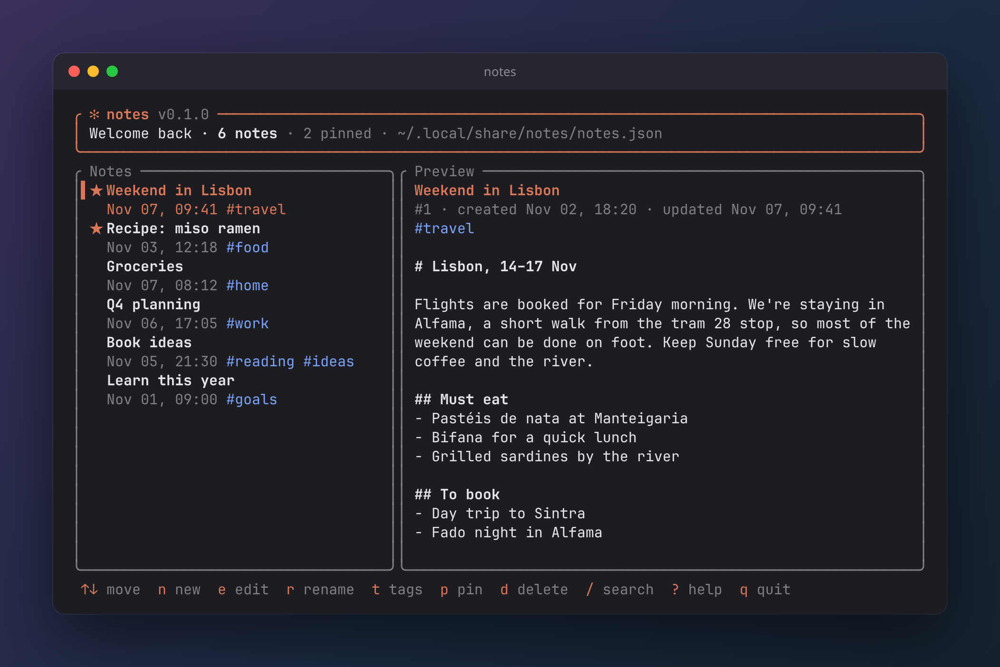
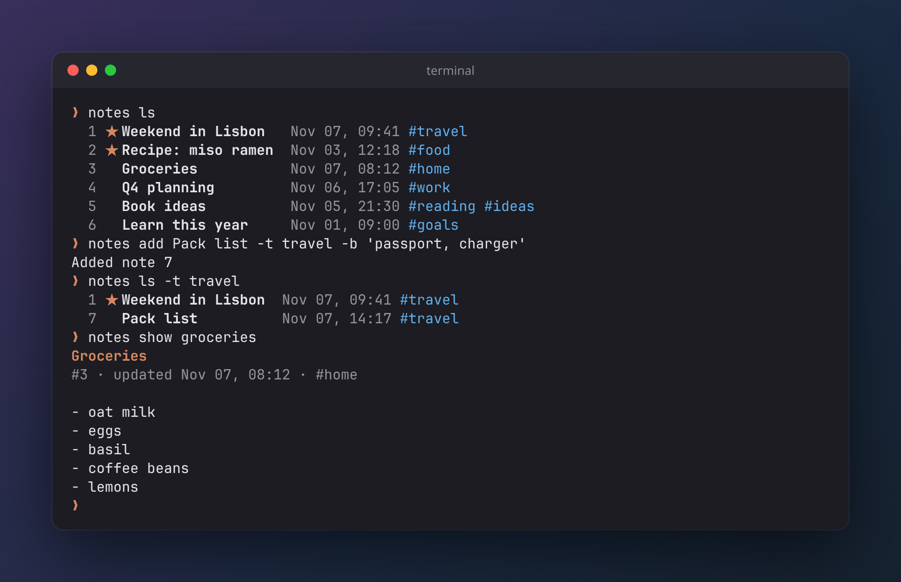
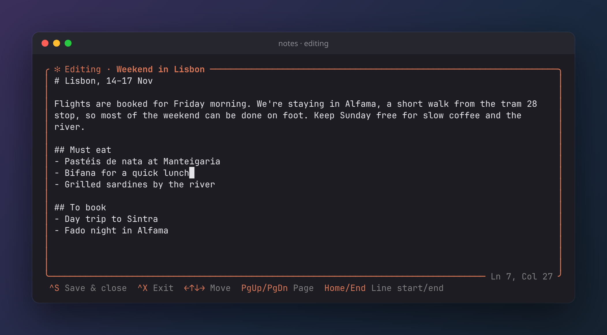

<h1 align="center">✻ notes</h1>

<p align="center">A tidy notebook for your terminal.<br>Fast, keyboard-driven, and one small binary.</p>

<p align="center">
  
</p>

## Install

macOS or Linux. No Rust knowledge needed; the installer sets up everything it needs.

Download `install.sh` from the [latest release](https://github.com/siddharthvkutty/cli-notes/releases/latest), make it executable, and run it:

```sh
curl -fsSL -o install.sh https://github.com/siddharthvkutty/cli-notes/releases/latest/download/install.sh
chmod +x install.sh
./install.sh
```

The `chmod +x` step is required. Downloaded files aren't executable until you give them permission.

Then open a new terminal and run `notes`. To uninstall, run `./install.sh` again.

## Use

Type `notes` to open the app. Press `?` inside for every key.

Or stay in the shell:

<p align="center">
  
</p>

Pipe anything in: `git log --oneline -5 | notes add "Recent commits"`

Run `notes -h` for all commands.

## Write

Bodies open in a built-in editor with its shortcuts shown along the bottom. Just type. `Ctrl-S` saves, `Ctrl-X` exits, and long lines wrap at word boundaries.

<p align="center">
  
</p>

## Features

- Editable titles and bodies, with a built-in editor (or bring your own via `NOTES_EDITOR`)
- Tags, pinning, and live search across titles, text and tags
- Plain JSON storage, saved safely and instantly
- Asks before it deletes anything

More detail in [DOCS.md](DOCS.md).
